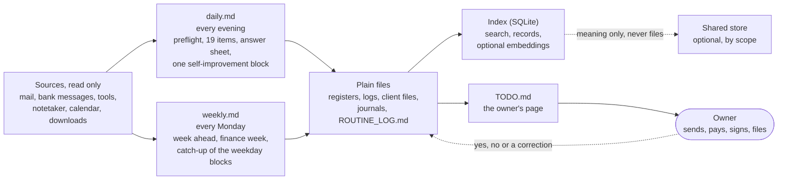

# Company brain

A template for running a small company on plain files and two scheduled AI routines: finance, operations, clients, meetings, sales and marketing in one folder that keeps itself current, tidies itself, and proposes its own improvements.

It is not a product and there is nothing to install to start: clone it, answer a few questions, and point your coding agent (Claude Code, Codex, Cursor or another) at the folder.

## What you get

- **A structure** for a whole company, with a rule file in every module (`AGENTS.md`), so any agent that opens a folder knows what it owns and what it must never do.
- **Two routines as files** (`00_Brain/SCHEDULES/`): a daily run with 19 checks and a twelve-question answer sheet, and a weekly run for the week ahead and the finance week. Your scheduler only says "run this file".
- **A self-improvement loop inside the daily run**, one block per weekday: Monday apply, Tuesday evaluate (the brain scores its own week and its own search), Wednesday enrich, Thursday clean up, Friday audit, Saturday dream, Sunday propose. Nothing changes without a written yes, and next week's score shows whether a change worked.
- **Registers** with fixed shapes: open loops, deadlines, recurring obligations, decisions, recommendations, open points, people, sources.
- **Honesty rules**: a source that failed is "not read", never "nothing new"; a figure carries its source and a certainty label; unknown stays unknown.
- **Legal entities kept apart** by rule and by code, for companies that have more than one.
- **An index** (`tools/index/`, Python standard library and SQLite): a catalogue of every file, full-text search, and business records read from the registers (deadlines, to-dos, decisions, meetings, clients, people, ledger lines).
- **Search by meaning, locally** (optional): a small embedding model on Apple silicon; 96 bytes per chunk for the first pass, then exact re-ranking.
- **A shared store** (optional): a Postgres schema for Supabase with access by scope, row-level security on every table, and a sync that uploads meaning (text chunks, records) and never files.
- **Self-maintenance**: time tiers, month and year rollups, register rollover by proposal, size budgets. Nothing is ever deleted by an agent.
- **A made-up company** (`examples/harbour-pine/`) with every register filled in, used by the tests.

## Start

```bash
git clone https://github.com/solutionplus-dev/company-brain.git my-company-brain && cd my-company-brain
python3 scripts/init.py            # company, time zone, legal entities
python3 tools/index/refresh.py     # build the index
scripts/brain ask "what is due this month"
```

Then read `docs/SETUP.md` to connect your mail, bank notifications, calendar and notetaker, and to schedule the two routines.

## How it runs



Twenty-one diagrams of every part (the daily run, a payment being matched, the weekly self-improvement loop, the search, what may leave the computer, the data model) are in `docs/DIAGRAMS.md`.

## What it is not

It does not replace a bookkeeper, a tax adviser or a lawyer. It keeps the papers in order, tells you what is due and what it could not read, and drafts. People send, pay, sign and file.

## Before you put your own brain on the internet

Don't. Keep your company's brain private: work in a private copy, not in a public fork (a fork of a public repository is public). If you publish anything derived from it, run `python3 scripts/audit_public.py --git --terms <your private list>` first: it fails on names, numbers and addresses you list as private, in the files and in the commit history. Publish as a fresh copy with one new commit, never by switching a privately developed repository to public: pull-request pages, comments and old commits would come along.

## Documentation

- `docs/HOW_IT_WORKS.md` — the ideas, in ten minutes.
- `docs/DIAGRAMS.md` — every routine and procedure as a flow chart, a sequence or a state diagram.
- `docs/SETUP.md` — sources, scheduling, the first week.
- `docs/SEARCH_AND_EMBEDDINGS.md` — the index, the local model, what was measured.
- `docs/STORE.md` — the shared store, scopes and what never leaves your computer.

## Licence and credits

MIT (see `LICENSE`). Ideas and thanks: `CREDITS.md`.
