# Diagrams

Every moving part of the brain as a picture. The routine files and the code stay the truth: when a diagram and `00_Brain/SCHEDULES/daily.md` disagree, the file is right and the diagram is fixed.

All diagrams are Mermaid, so they render on GitHub and in most editors, and you can change them in a text editor.

| # | Diagram | Kind | Answers |
|---|---|---|---|
| 1 | [The whole system](#1-the-whole-system) | flow chart | What reads what, and where does it end up? |
| 2 | [A day](#2-a-day) | sequence | Who does what between the evening run and the next morning? |
| 3 | [The daily run, step by step](#3-the-daily-run-step-by-step) | flow chart | In which order does the run work, and what is cut first? |
| 4 | [One checklist item](#4-one-checklist-item-done-nothing-or-not-read) | flow chart | When is the answer "nothing" and when "not read"? |
| 5 | [An invoice arrives](#5-an-invoice-arrives) | flow chart | Which legal entity gets it, and where is it filed? |
| 6 | [A payment is matched](#6-a-payment-is-matched) | sequence | When does a journal line get the label `proof`? |
| 7 | [A client asks for something](#7-a-client-asks-for-something) | sequence | Who drafts, who sends, and when is the row ticked? |
| 8 | [A meeting is filed](#8-a-meeting-is-filed) | sequence | What is written after a call, and where? |
| 9 | [The week the brain spends on itself](#9-the-week-the-brain-spends-on-itself) | flow chart | How does it improve without changing its own rules? |
| 10 | [The life of a proposal](#10-the-life-of-a-proposal) | state | What happens after a yes, a no, or silence? |
| 11 | [Monday: the weekly run and its catch-up](#11-monday-the-weekly-run-and-its-catch-up) | flow chart | What does Monday repeat, and what does it only read? |
| 12 | [The dream](#12-the-dream) | flow chart | What does it read, and what may it change? |
| 13 | [Two files disagree](#13-two-files-disagree) | flow chart | Which file wins? |
| 14 | [How old material is folded](#14-how-old-material-is-folded) | flow chart and state | How does the brain stay small without deleting? |
| 15 | [Building the index](#15-building-the-index) | flow chart | What happens on `refresh.py`? |
| 16 | [A search](#16-a-search) | sequence | How do keywords and meaning come together? |
| 17 | [What may leave the computer](#17-what-may-leave-the-computer) | flow chart | Which gates does a file pass before the shared store? |
| 18 | [Reading the shared store](#18-reading-the-shared-store) | sequence | What does a team member see, and what does a stranger get? |
| 19 | [The data model](#19-the-data-model) | entity relationship | Which tables exist, locally and in the store? |
| 20 | [Several brains, one scheduler](#20-several-brains-one-scheduler) | flow chart | How do linked brains hang together? |
| 21 | [Setup and the first two weeks](#21-setup-and-the-first-two-weeks) | flow chart | What do I do first? |

At the end: [how to draw your own](#drawing-your-own).

---

## 1. The whole system

Sources are read by two routines. The routines write plain files. The index is built from the files, never the other way round.

```mermaid
flowchart LR
  subgraph S["Sources (read only)"]
    S1["Mailboxes"]
    S2["Bank messages"]
    S3["Invoicing and bookkeeping tools"]
    S4["Notetaker and recordings"]
    S5["Calendar"]
    S6["Downloads and INBOX"]
  end

  subgraph R["Two routines, each a file"]
    R1["daily.md<br/>every evening"]
    R2["weekly.md<br/>Monday morning"]
  end

  subgraph F["Plain files (the truth)"]
    F1["Registers<br/>deadlines, open loops, obligations"]
    F2["Logs<br/>daily, weekly, routine log"]
    F3["Client files"]
    F4["Journals per legal entity"]
    F5["Originals with a digest beside them"]
  end

  subgraph I["Index (rebuilt from the files)"]
    I1["Catalogue and full-text search"]
    I2["Business records"]
    I3["Embeddings, optional"]
  end

  S --> R1
  S --> R2
  R1 --> F
  R2 --> F
  F --> I
  I --> Q["scripts/brain<br/>ask, records, file, check"]
  I -. "optional, by scope" .-> ST["Shared store"]
  F --> T["TODO.md<br/>the owner's page"]
  T --> O(["Owner<br/>sends, pays, signs, files"])
  O -. "yes, no or a correction" .-> F
```

## 2. A day

The agent reads and files in the evening. The owner acts in the morning. Nothing is sent by the agent.

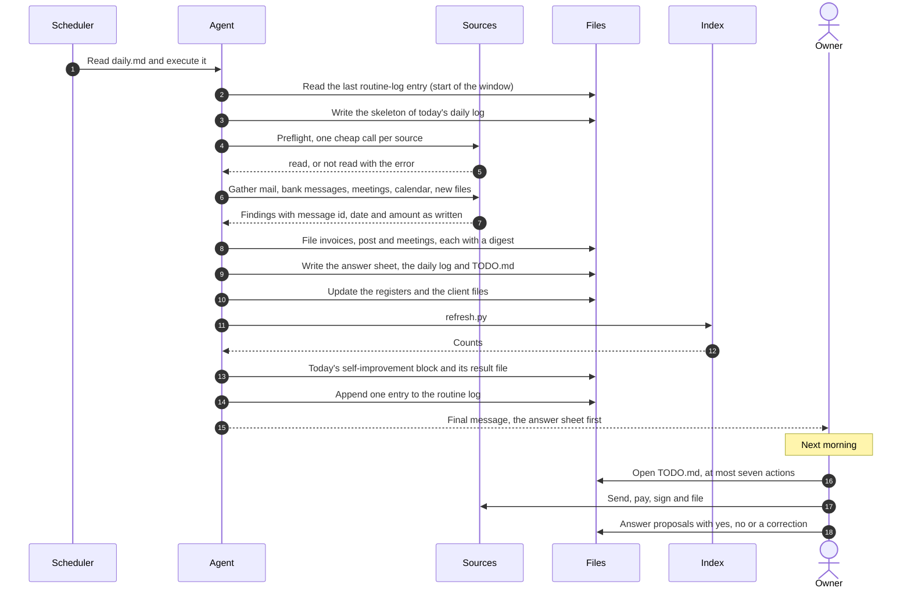

## 3. The daily run, step by step

The dotted line is the order of sacrifice when time or tools run short. The answer sheet, the daily log, `TODO.md` and the routine-log entry are never cut.

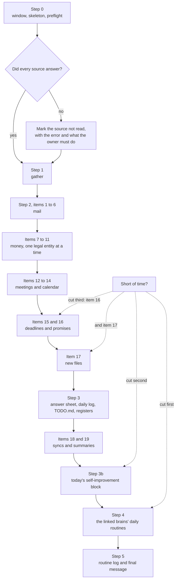

## 4. One checklist item: done, nothing or not read

The rule behind the answer sheet. A source that failed is never reported as "nothing new".

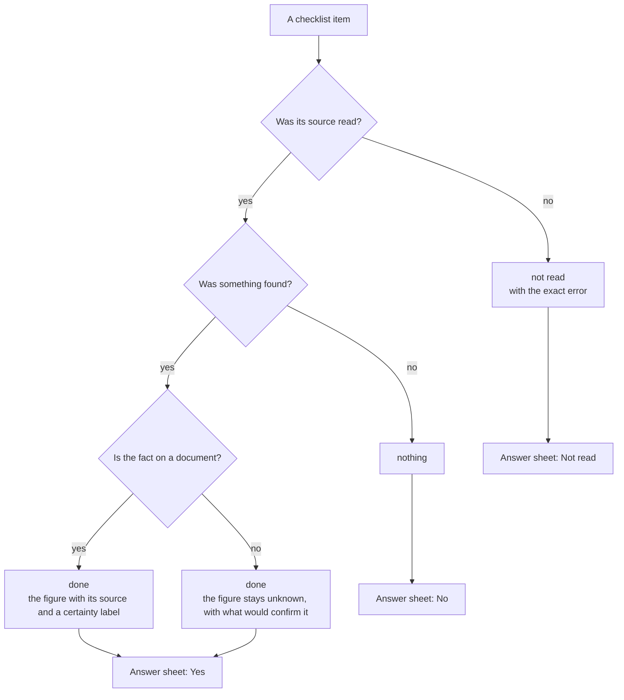

## 5. An invoice arrives

The legal entity comes from the name printed on the invoice, never from the card that paid. Each entity has its own folders, its own journal and its own section in the daily log.

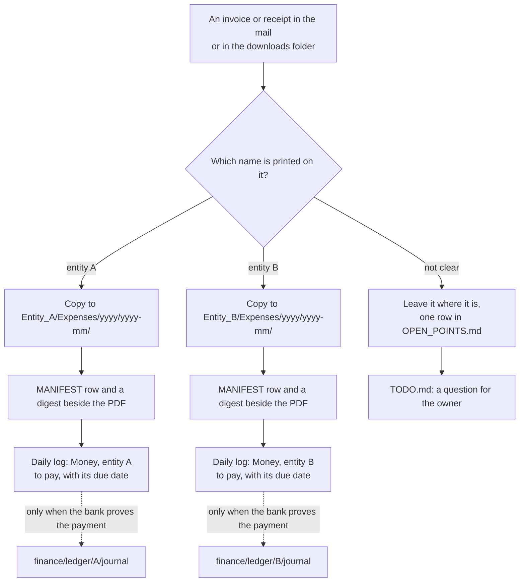

The two columns never meet: no line, no sum and no currency column holds both entities. An invoice that arrived is filed and listed as to pay; it becomes a journal line only with the bank's proof (next diagram).

## 6. A payment is matched

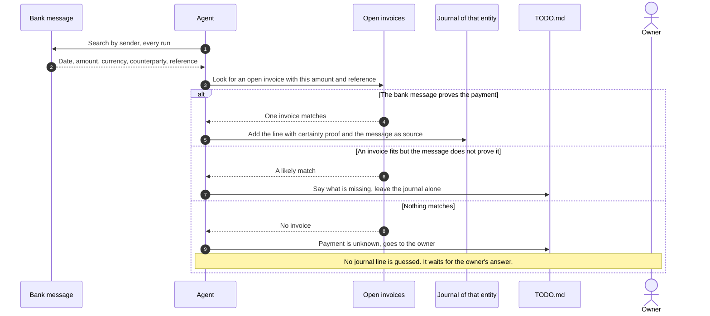

## 7. A client asks for something

The agent writes the request down and drafts. The owner sends. The row is ticked only when the reply is visible in sent mail.

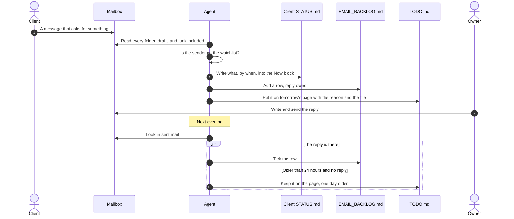

## 8. A meeting is filed

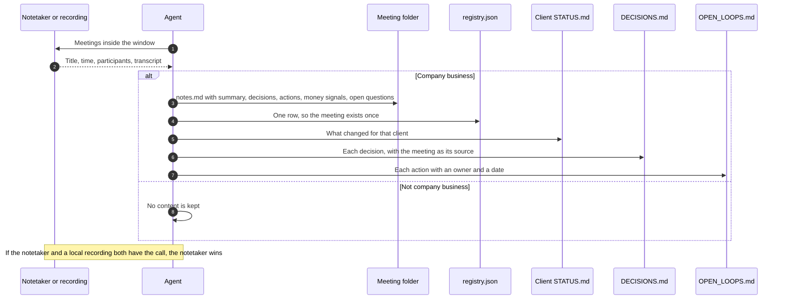

## 9. The week the brain spends on itself

One block a day inside the daily run, about fifteen minutes each. A block proposes and prepares. Only Monday applies, and only what carries a written yes.

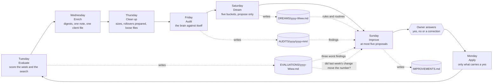

## 10. The life of a proposal

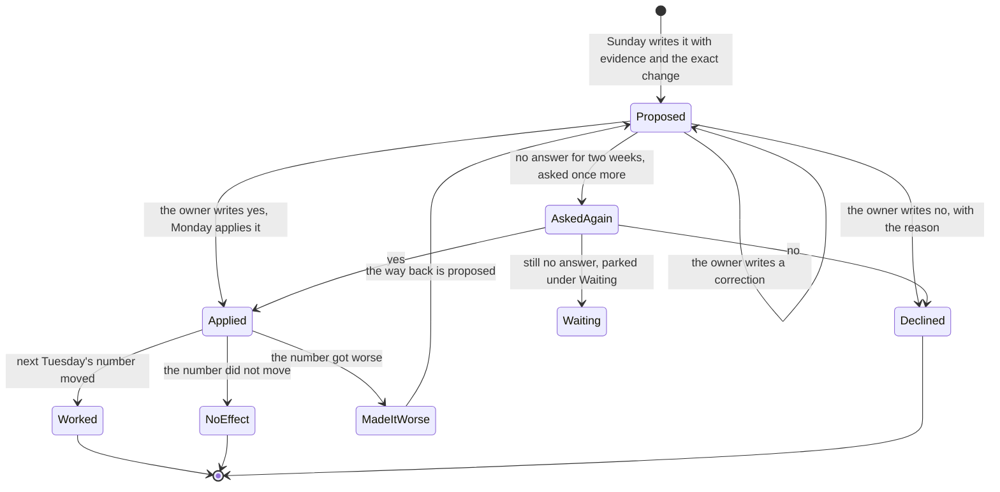

## 11. Monday: the weekly run and its catch-up

Part A is written first so that it exists even if a later part fails. A block that already ended `done` during the week is read, not repeated.

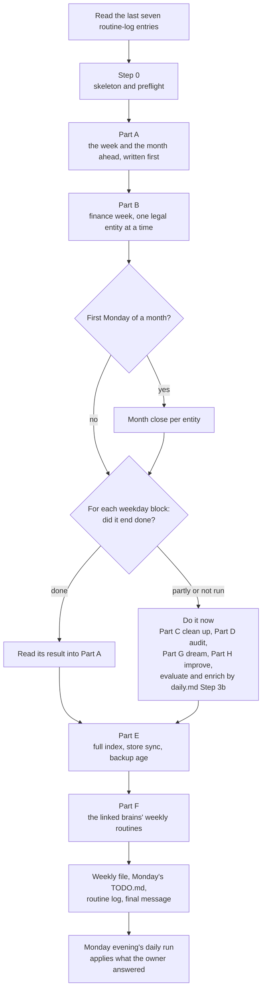

## 12. The dream

Once a week the brain reads everything and thinks about the company while nobody is asking. It changes nothing.

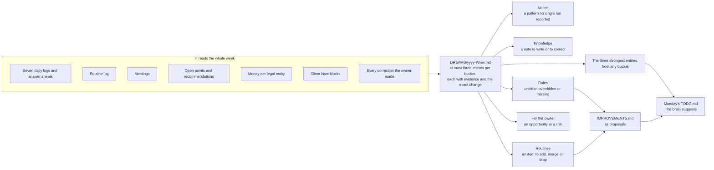

## 13. Two files disagree

Every kind of fact has one owning file (`00_Brain/SYSTEM/SYSTEM_OF_RECORDS.md`). Everything else links to it.

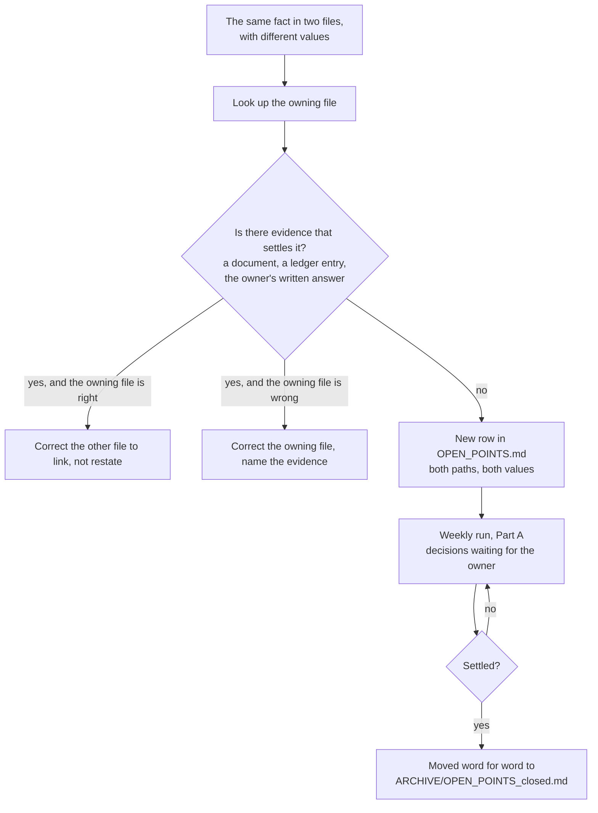

## 14. How old material is folded

Nothing is removed. What is current is found first; what is old is one step further away.

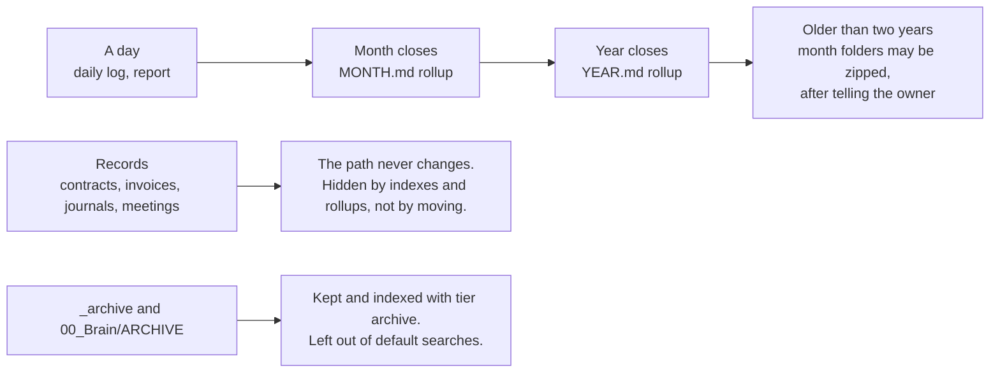

A register (open loops, deadlines, mail backlog) holds the current month and everything still open. Older closed blocks roll over, by proposal:

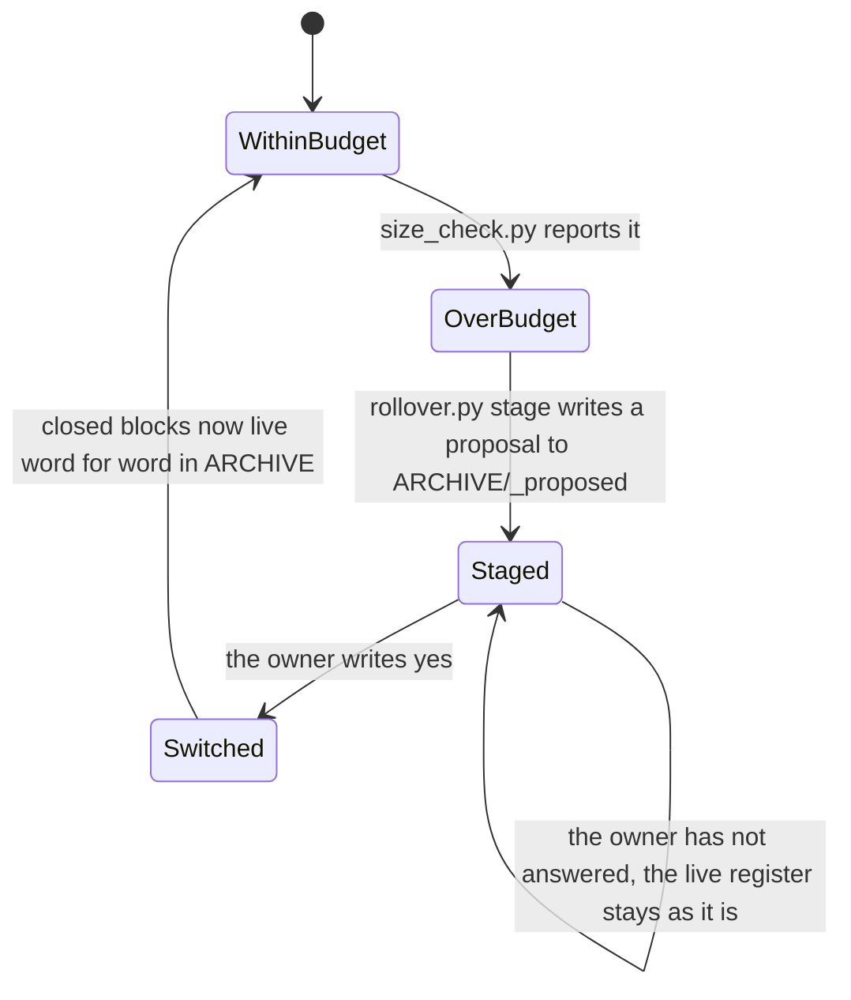

## 15. Building the index

`python3 tools/index/refresh.py`. Incremental every day, `--full` on Monday. A failure in the importers or the embedder is recorded and never stops the run.

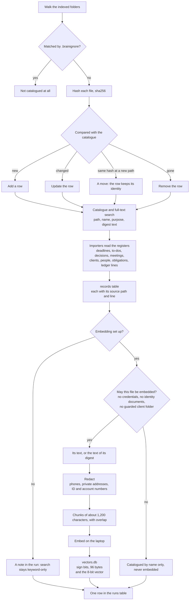

## 16. A search

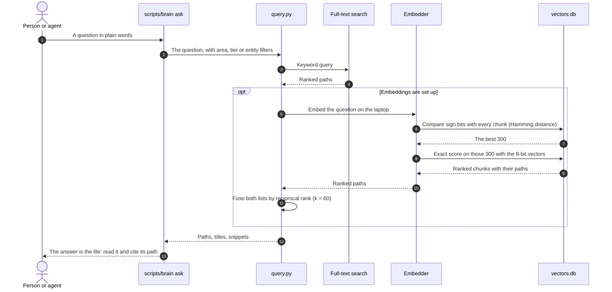

## 17. What may leave the computer

Only for the optional shared store. One file decides: `tools/index/supabase/scopes.json`. File bytes never go up, only text chunks from text files and digests, their embeddings, and records.

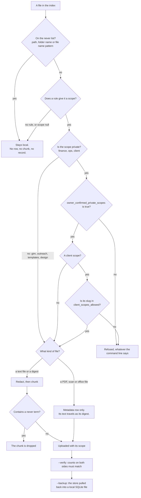

Run `--plan` first: it prints this decision per scope and uploads nothing.

## 18. Reading the shared store

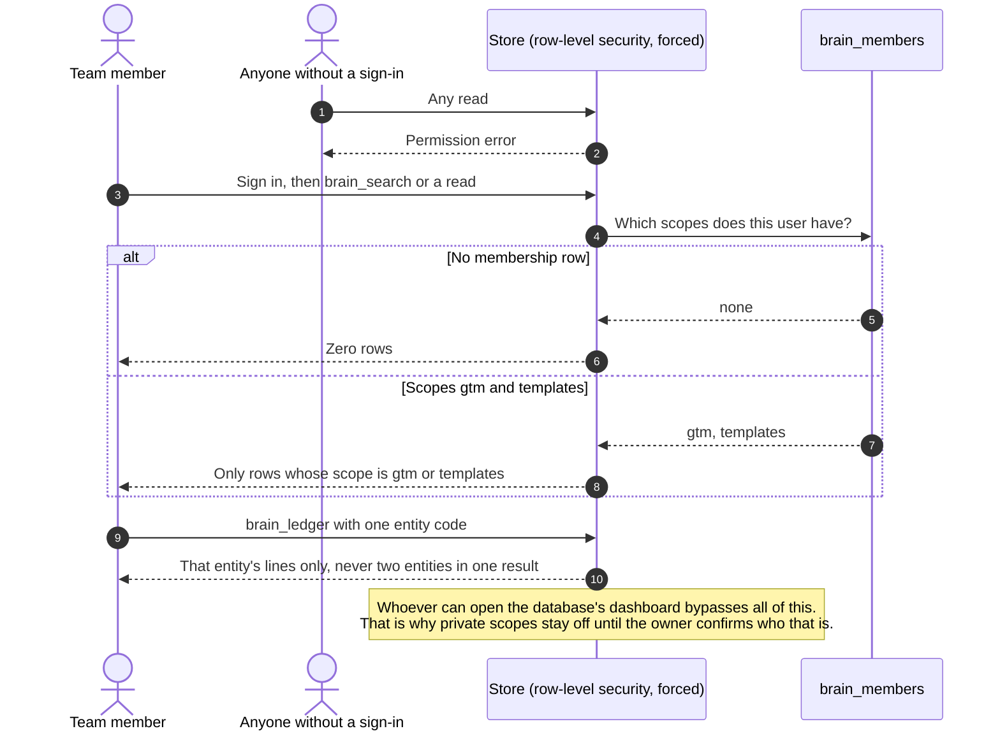

## 19. The data model

The local index, `.index/vault_index.db` and `.index/vectors.db`. Both are rebuilt from the files and can be deleted and built again.

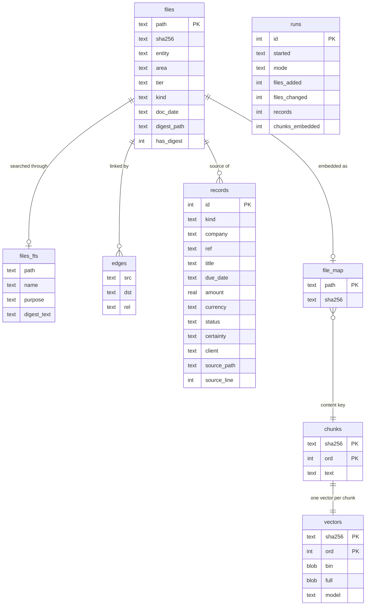

The shared store. Every table carries a scope, and a member sees only the scopes in their own row.

```mermaid
erDiagram
  brain_documents ||--o{ brain_chunks : "has"
  brain_chunks ||--o| brain_embeddings : "has"
  brain_members }o--o{ brain_documents : "may read, by scope"
  brain_members }o--o{ brain_records : "may read, by scope"

  brain_documents {
    uuid id PK
    scope scope
    text module
    text path
    text sha256
    text company
    text area
    text tier
    bool has_digest
  }
  brain_chunks {
    uuid id PK
    uuid document_id FK
    scope scope
    int ord
    text text
  }
  brain_embeddings {
    uuid chunk_id PK
    scope scope
    bit bin
    halfvec full
    text model
  }
  brain_records {
    uuid id PK
    scope scope
    text kind
    text company
    text ref
    numeric amount
    text currency
    text certainty
    text source_path
  }
  brain_edges {
    uuid id PK
    scope scope
    text src
    text dst
    text rel
  }
  brain_members {
    uuid user_id PK
    scope_array scopes
  }
  brain_sync_runs {
    bigint id PK
    scope scope
    text mode
    text status
    int documents
    int chunks
    int blocked
  }
```

## 20. Several brains, one scheduler

The core stays private on the owner's computer. Other brains live in their own repositories and are reached through links under `Repos/`, never copies.

```mermaid
flowchart TD
  subgraph CORE["Core brain (private, the owner's computer)"]
    C1["Finance and operations"]
    C2["Clients and meetings"]
    C3["daily.md and weekly.md"]
  end

  subgraph LINKED["Linked under Repos/, each its own repository"]
    L1["Go-to-market and sales"]
    L2["Outreach"]
    L3["Design system and templates"]
    L4["One brain per client project"]
  end

  C3 -- "Step 4 and Part F run<br/>schedules/daily.md and weekly.md" --> L1
  C3 --> L2
  C3 --> L3
  C3 --> L4

  L1 -. "five-line result" .-> C3
  L4 -. "five-line result" .-> C3

  L4 --> DH{"brain/DATA_HANDLING.md<br/>says sync: yes?"}
  DH -- "no, confidential,<br/>or the file is missing" --> LOC["Stays on the computer"]
  DH -- "yes" --> STORE["Shared store, scope client:slug"]
  L1 --> STORE2["Shared store, scope gtm"]
```

Who owns which fact across brains: the core owns billing entity, contracts, invoices, payments and profitability; a client brain owns scope, plan, deliverables, decisions and risks of that project; a code repository owns build facts.

## 21. Setup and the first two weeks

```mermaid
flowchart TD
  A["Clone the template"] --> B["python3 scripts/init.py<br/>company, time zone, legal entities"]
  B --> C["Fill 00_Brain/SOURCES.md<br/>where each source is read, and a cheap test"]
  C --> D["Enter what you know<br/>obligations, clients, people, marketing base"]
  D --> E["python3 tools/index/refresh.py --full<br/>python3 tests/test_smoke.py"]
  E --> F["Run daily.md once by hand<br/>and read the result beside the file"]
  F --> G["Schedule the two routines"]
  G --> H["Week one<br/>many not read and unknown answers"]
  H --> I{"For each gap"}
  I -- "a source is not connected" --> J["Connect it"]
  I -- "a document is missing" --> K["Find it and put it in INBOX"]
  J --> L["Second Monday<br/>the answer sheet is mostly Yes and No"]
  K --> L
  L --> O1["Optional: search by meaning"]
  L --> O2["Optional: a shared store for a team"]
```

---

## Drawing your own

Your brain will grow procedures this template does not have: how a quote becomes a contract, how a new client is taken on, how a month is closed with your adviser. Draw them the same way.

- **One diagram answers one question.** Write the question above it.
- **Pick the kind by the question.** Who talks to whom and in which order: a sequence diagram. Which way does it go and where does it branch: a flow chart. Which states can a thing be in: a state diagram. Which tables or files belong together: an entity relationship diagram.
- **Draw the honest branches too:** not read, unknown, refused, waiting for the owner. They are where the routine earns its keep.
- **Name roles, not people.** "Owner", "Bookkeeper", "Client". A diagram is copied further than the file it sits in.
- **Keep it beside what it explains** (a procedure's diagram in that module's folder) and link it from here.
- **The file stays the truth.** When you change a routine, change its diagram in the same edit; Friday's audit lists diagrams that name a step the routine no longer has.

A starting point for a procedure of your own:

````markdown
```mermaid
sequenceDiagram
  autonumber
  actor CL as Client
  participant AG as Agent
  participant FS as Files
  actor OWN as Owner

  CL->>AG: What starts it
  AG->>FS: What is written down, and where
  AG-->>OWN: What is drafted for the owner
  OWN->>CL: What only the owner does
```
````
